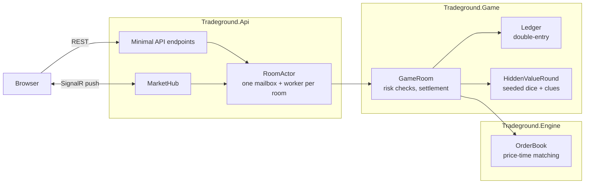

# Tradeground

**A playground for learning to trade.** Real charts, pretend money, and three games that go from
your first price chart to how professional trading firms think. Free, in the browser, no sign-up.

| Game | Level | Teaches | Players |
|---|---|---|---|
| **Up or Down** | Easy | Reading price charts | Solo |
| **Trade Through History** *(coming soon)* | Medium | Buying, selling and stop-losses, like a real trading app | Solo |
| **Market Maker** | Advanced | How trading firms make money | 2+ (host + players) |

Every game has a short **How to play** guide, shown automatically the first time someone plays.

## The games

### Up or Down

A real chart, cut off at "now". Pick a timeframe, call **Up** or **Down** once, then watch the next 20 candles
replay and find out whether you were right, and which market and dates it was. A run keeps your right/wrong
tally and your streak.

| Timeframes | Markets | Data |
|---|---|---|
| 1m, 15m, 30m, 1h, 4h | BTC, ETH, BNB, XRP against USDT | [Binance public data](https://data.binance.vision), CC BY-NC-SA 4.0 |
| 1w | EUR/USD, GBP/USD, USD/JPY, AUD/USD, USD/CAD, USD/CHF | Federal Reserve H.10 daily rates via FRED, public domain |

- **Many charts from a small file.** Each crypto market and timeframe keeps 160-candle slices from ten different
  months between 2019 and 2026 (calm markets, crashes, rallies); forex keeps the full weekly history from 2000.
  [`tools/Tradeground.ChartData`](tools/Tradeground.ChartData) downloads the sources and rebuilds both files.
- **Nothing to peek at.** The server deals the chart and keeps the future candles until you call. Prices are
  shown as an index starting at 100 and candles carry no timestamps, so neither the price level nor the dates
  give the market away.
- **Checked data.** Every candle is validated at startup (high and low contain open and close, times in order),
  and a test checks candles are spaced exactly one timeframe apart. Prices are integers end to end; the import
  refuses any price it would have to round.

### Market Maker

Picture an airport currency booth: it buys dollars a little cheaper than it sells them, and earns
the gap. In Market Maker, the players are the booths.

Every round has a **hidden value**. In *Ten Dice*, the contract settles at the sum of ten hidden
six-sided dice (expected value with no information: 35). Each player privately sees one die.
Players trade with each other on a live limit order book; the host reveals dice as public
"news" during the round. At the end, every position is closed at the true value and players
are ranked by profit and loss.

Two versions share one engine:

| Mode | Audience | Example |
|---|---|---|
| Explorer | Younger players | *Lemonade Stand*: jugs are worth 2 coins per lemon in six hidden crates |
| Trader | Teens and adults | *Ten Dice*: full order book, limit and market orders |

Modes are JSON files in [`src/Tradeground.Game/Modes`](src/Tradeground.Game/Modes).

## Architecture



| Project | Responsibility |
|---|---|
| `Tradeground.Engine` | Limit order book and matching engine. Pure C#, no I/O, deterministic. |
| `Tradeground.Game` | Game rules: hidden values, clues, ledger, position limits, settlement. |
| `Tradeground.Api` | ASP.NET Core minimal API, SignalR hub, per-room actors, guest sessions. Also serves the web app from `wwwroot`. |

### Key design decisions

- **Integer prices.** No floating point anywhere money is involved.
- **Price-time priority.** Best price first; at the same price, earliest order first. Trades execute at the resting order's price.
- **Single-threaded book, actor per room.** Requests are queued into a bounded `Channel`; one worker owns each room. No locks, strict ordering, backpressure (HTTP 503 when a room's mailbox is full).
- **Deterministic.** A seeded SplitMix64 generator makes every round reproducible, which enables Daily Challenges and exact replays.
- **Double-entry ledger.** Cash and contracts only ever move between accounts; trading is provably zero-sum.
- **Pre-trade risk.** Orders are rejected if the worst case (all open orders filling) breaks the position limit.
- **Self-trade prevention.** An order never matches the same trader's resting order.
- **Privacy by design.** Guest sessions with random 128-bit keys, generated display names, no personal data, anonymous trade tape.
- **Expiry cancels resting orders.** At settlement every open order is cancelled, as on a real exchange, and the hidden dice are revealed.

### Web app

Plain HTML, CSS and JavaScript modules in [`src/Tradeground.Api/wwwroot`](src/Tradeground.Api/wwwroot): no framework
and no build step, served by the API itself so one container ships everything.

- **Fair value, live.** The dice rail shows what each player knows (their private die plus public news) and the
  expected value and range that follow from it. That calculation is the lesson of the game.
- **Two vocabularies.** Explorer mode says *buyers, sellers, coins, crates* and hides market orders;
  Trader mode says *bids, asks, position* and shows the full ticket.
- **Live without losing input.** REST for actions, SignalR for pushes. The client subscribes *before* fetching
  state so no event falls in the gap, drops duplicates by sequence number, and re-renders only the region that
  changed, so typing in the order ticket is never interrupted.
- **Nothing from third parties.** Fonts and the SignalR client are vendored under `wwwroot/lib`, so a strict
  `Content-Security-Policy: default-src 'self'` holds and no outside service sees players' IP addresses.
- **Accessible.** Keyboard-operable book and ticket, visible focus, screen-reader labels on dice and price levels,
  blue/orange instead of green/red for colour-blind players, reduced-motion respected, works down to phone width.

## Running locally

Requirements: [.NET 10 SDK](https://dotnet.microsoft.com/download/dotnet/10.0); Docker for the container stack.

```bash
dotnet test
```

```bash
dotnet run --project src/Tradeground.Api
```

Then open the URL it prints: host a game in one tab and join it from another tab or a phone on the same network.

```bash
docker compose up --build
```

Then check `http://localhost:8080/health` (Docker) or the URL printed by `dotnet run`.

### API at a glance

| Method | Path | Who | Purpose |
|---|---|---|---|
| GET | `/api/modes` | anyone | List game modes |
| POST | `/api/rooms` | host | Create a room (`{ "modeId": "trader-dice" }`); returns room code and host key |
| POST | `/api/rooms/{code}/players` | player | Join; returns trader key, generated name and private clue |
| GET | `/api/rooms/{code}` | anyone | Public room state: mode, phase, news so far, recent trades, results |
| GET | `/api/rooms/{code}/book` | anyone | Order book snapshot |
| GET | `/api/rooms/{code}/me` | player | Name, private clue, cash, position and resting orders |
| POST | `/api/rooms/{code}/orders` | player | Place an order |
| DELETE | `/api/rooms/{code}/orders/{id}` | player | Cancel an order |
| POST | `/api/rooms/{code}/clues` | host | Reveal the next public clue |
| POST | `/api/rooms/{code}/settlement` | host | End the round and rank players |
| GET | `/api/charts/timeframes` | anyone | Chart Replay timeframes and their market type |
| POST | `/api/charts` | anyone | Start a run (`{ "timeframe": "15m" }`); returns a chart key and the first chart's history |
| GET | `/api/charts/mine` | chart player | Current chart (for a page refresh) |
| POST | `/api/charts/mine/call` | chart player | Call it (`{ "direction": "Up" }`); reveals the next 20 candles, the market and the dates |
| POST | `/api/charts/mine/next` | chart player | Deal a new chart on any timeframe |

Players send `X-Trader-Key`; hosts send `X-Host-Key`; Chart Replay sends `X-Chart-Key`.
Real-time updates: connect to `/hubs/market`, call `Subscribe(code)`, then listen for
`bookUpdated`, `tradesExecuted`, `clueRevealed`, `playerJoined` and `roundSettled`.

## Testing

| Layer | Tooling | Runs |
|---|---|---|
| Unit tests (market rules as test names) | xUnit, Shouldly | Every push |
| Property-based tests (invariants over random order flow) | FsCheck | Every push |
| Model-based test (optimised book vs. a simple model) | FsCheck | Every push |
| Integration tests (real app over HTTP and SignalR) | WebApplicationFactory | Every push |
| Chart data checks (every candle valid, in order, evenly spaced) | Validated at startup and in tests | Every push |
| Benchmarks (orders/sec, allocations) | BenchmarkDotNet | Nightly |

Invariants checked on random sessions: the book is never crossed; every order is fully
accounted for; trades respect both prices; no self-trades; total cash is constant; net position
is zero; position limits always hold; settlement P&L sums to zero.

```bash
dotnet run -c Release --project benchmarks/Tradeground.Benchmarks
```

## Roadmap

- [x] Matching engine, game rules, REST + SignalR API, tests, CI, Docker
- [x] Web frontend (Explorer and Trader views)
- [ ] Market-maker bots
- [ ] Round timer, automatic clue schedule, room clean-up
- [ ] Postgres persistence and event-sourced replays; Redis SignalR backplane
- [ ] Playwright end-to-end tests, Testcontainers integration tests, load tests
- [ ] Daily Challenge, leaderboards, ratings, achievements
- [ ] Post-game coach (adverse selection, inventory risk, spread capture)
- [ ] AWS deployment (ECR, ECS Fargate, RDS, ElastiCache) with Terraform and a deploy pipeline

## Data and third-party assets

Chart Replay data:
- Forex: Board of Governors of the Federal Reserve System (US), H.10 Foreign Exchange Rates, retrieved from
  [FRED](https://fred.stlouisfed.org/), Federal Reserve Bank of St. Louis. Public domain.
- Crypto: [Binance public market data](https://data.binance.vision), licensed
  [CC BY-NC-SA 4.0](https://creativecommons.org/licenses/by-nc-sa/4.0/). The derived file
  `src/Tradeground.Game/Charts/crypto-intraday.json` is shared under the same license. Because of the
  non-commercial term, a paid version of Tradeground would need a different intraday data source.

Vendored in `src/Tradeground.Api/wwwroot/lib`, each under its own license:
[SignalR JavaScript client](https://github.com/dotnet/aspnetcore) (MIT),
[Bricolage Grotesque](https://github.com/ateliertriay/bricolage) and [IBM Plex Sans](https://github.com/IBM/plex)
(SIL Open Font License 1.1; license texts alongside the font files).

## Disclaimer

Educational simulation. Not financial advice. No real money is involved.
