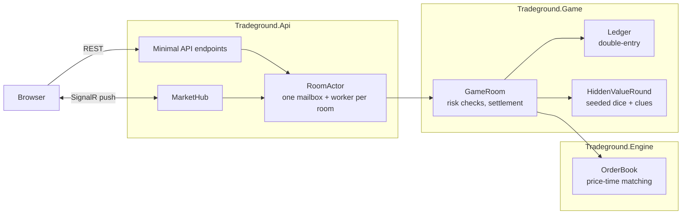

# Tradeground

A free, browser-based trading game that teaches how markets really work: from kids learning
supply and demand to students preparing for trading-firm interviews.
Real order book, real price discovery, zero real money.

## How a round works

Every round has a **hidden value**. In *Ten Dice*, the contract settles at the sum of ten hidden
six-sided dice (expected value with no information: 35). Each player privately sees one die.
Players trade with each other on a live limit order book; the host reveals dice as public
"news" during the round. At the end, every position is closed at the true value and players
are ranked by profit and loss.

Two audiences share one engine:

| Mode | Audience | Example |
|---|---|---|
| Explorer | Younger players | *Lemonade Stand*: jugs are worth 2 coins per lemon in six hidden crates |
| Trader | Teens and adults new to trading | *Ten Dice*: full order book, limit and market orders |

Modes are JSON files in [`src/Tradeground.Game/Modes`](src/Tradeground.Game/Modes).

## Architecture



| Project | Responsibility |
|---|---|
| `Tradeground.Engine` | Limit order book and matching engine. Pure C#, no I/O, deterministic. |
| `Tradeground.Game` | Game rules: hidden values, clues, ledger, position limits, settlement. |
| `Tradeground.Api` | ASP.NET Core minimal API, SignalR hub, per-room actors, guest sessions. |

### Key design decisions

- **Integer prices.** No floating point anywhere money is involved.
- **Price-time priority.** Best price first; at the same price, earliest order first. Trades execute at the resting order's price.
- **Single-threaded book, actor per room.** Requests are queued into a bounded `Channel`; one worker owns each room. No locks, strict ordering, backpressure (HTTP 503 when a room's mailbox is full).
- **Deterministic.** A seeded SplitMix64 generator makes every round reproducible, which enables Daily Challenges and exact replays.
- **Double-entry ledger.** Cash and contracts only ever move between accounts; trading is provably zero-sum.
- **Pre-trade risk.** Orders are rejected if the worst case (all open orders filling) breaks the position limit.
- **Self-trade prevention.** An order never matches the same trader's resting order.
- **Privacy by design.** Guest sessions with random 128-bit keys, generated display names, no personal data, anonymous trade tape.

## Running locally

Requirements: [.NET 10 SDK](https://dotnet.microsoft.com/download/dotnet/10.0); Docker for the container stack.

```bash
dotnet test
```

```bash
dotnet run --project src/Tradeground.Api
```

```bash
docker compose up --build
```

Then check `http://localhost:8080/health` (Docker) or the URL printed by `dotnet run`.

### API at a glance

| Method | Path | Who | Purpose |
|---|---|---|---|
| GET | `/api/modes` | anyone | List game modes |
| POST | `/api/rooms` | host | Create a room (`{ "modeId": "trader-dice" }`); returns room code and host key |
| POST | `/api/rooms/{code}/players` | player | Join; returns trader key, generated name and private clue |
| GET | `/api/rooms/{code}/book` | anyone | Order book snapshot |
| GET | `/api/rooms/{code}/me` | player | Cash and position |
| POST | `/api/rooms/{code}/orders` | player | Place an order |
| DELETE | `/api/rooms/{code}/orders/{id}` | player | Cancel an order |
| POST | `/api/rooms/{code}/clues` | host | Reveal the next public clue |
| POST | `/api/rooms/{code}/settlement` | host | End the round and rank players |

Players send `X-Trader-Key`; hosts send `X-Host-Key`.
Real-time updates: connect to `/hubs/market`, call `Subscribe(code)`, then listen for
`bookUpdated`, `tradesExecuted`, `clueRevealed` and `roundSettled`.

## Testing

| Layer | Tooling | Runs |
|---|---|---|
| Unit tests (market rules as test names) | xUnit, Shouldly | Every push |
| Property-based tests (invariants over random order flow) | FsCheck | Every push |
| Model-based test (optimised book vs. a simple model) | FsCheck | Every push |
| Integration tests (real app over HTTP and SignalR) | WebApplicationFactory | Every push |
| Benchmarks (orders/sec, allocations) | BenchmarkDotNet | Nightly |

Invariants checked on random sessions: the book is never crossed; every order is fully
accounted for; trades respect both prices; no self-trades; total cash is constant; net position
is zero; position limits always hold; settlement P&L sums to zero.

```bash
dotnet run -c Release --project benchmarks/Tradeground.Benchmarks
```

## Roadmap

- [x] Matching engine, game rules, REST + SignalR API, tests, CI, Docker
- [ ] Web frontend (Explorer and Trader views)
- [ ] Market-maker bots
- [ ] Round timer, automatic clue schedule, room clean-up
- [ ] Postgres persistence and event-sourced replays; Redis SignalR backplane
- [ ] Playwright end-to-end tests, Testcontainers integration tests, load tests
- [ ] Daily Challenge, leaderboards, ratings, achievements
- [ ] Post-game coach (adverse selection, inventory risk, spread capture)
- [ ] AWS deployment (ECR, ECS Fargate, RDS, ElastiCache) with Terraform and a deploy pipeline

## Disclaimer

Educational simulation. Not financial advice. No real money is involved.
