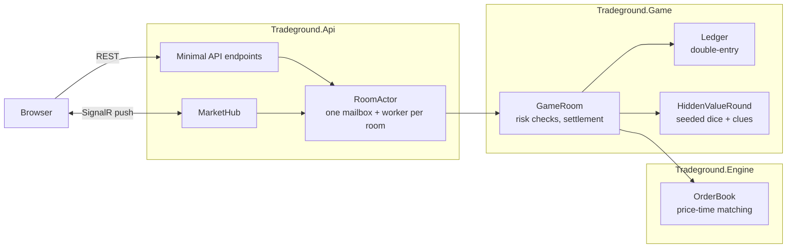

# Tradeground

A free, browser-based trading game that teaches how markets really work: from kids learning
supply and demand to students preparing for trading-firm interviews.
Real order book, real price discovery, zero real money.

## How a round works

Every round has a **hidden value**. In *Ten Dice*, the contract settles at the sum of ten hidden
six-sided dice (expected value with no information: 35). Each player privately sees one die.
Players trade with each other on a live limit order book; the host reveals dice as public
"news" during the round. At the end, every position is closed at the true value and players
are ranked by profit and loss.

Two audiences share one engine:

| Mode | Audience | Example |
|---|---|---|
| Explorer | Younger players | *Lemonade Stand*: jugs are worth 2 coins per lemon in six hidden crates |
| Trader | Teens and adults new to trading | *Ten Dice*: full order book, limit and market orders |

Modes are JSON files in [`src/Tradeground.Game/Modes`](src/Tradeground.Game/Modes).

### Chart Replay (solo practice)

A real currency chart, one candle per week, with the pair and the dates hidden. Each week the player calls
**Strong bear, Bear, Not sure, Bull or Strong bull**; then the next week is revealed. After 20 weeks the game
reveals which market and which years it was.

- **Real data, no strings attached.** Weekly candles for six major pairs (EUR/USD, GBP/USD, USD/JPY,
  AUD/USD, USD/CAD, USD/CHF) from 2000 to today, built from the Federal Reserve's daily H.10 rates, which are
  public domain. [`tools/Tradeground.ChartData`](tools/Tradeground.ChartData) regenerates the file.
- **Nothing to peek at.** The server holds the future candles and sends each one only after it is called.
  Prices are shown as an index starting at 100, so the price level can't give the pair away.
- **A proper scoring rule.** Each choice states a probability of an up-week (10%, 30%, 50%, 70%, 90%), scored
  as `100 - (stated% - actual%)² / 25`: +96 for confident and right, -224 for confident and wrong, 0 for
  "Not sure". The rule is *proper*: over many weeks, saying what you really believe scores best, so the game
  rewards calibration rather than bravado.

## Architecture



| Project | Responsibility |
|---|---|
| `Tradeground.Engine` | Limit order book and matching engine. Pure C#, no I/O, deterministic. |
| `Tradeground.Game` | Game rules: hidden values, clues, ledger, position limits, settlement. |
| `Tradeground.Api` | ASP.NET Core minimal API, SignalR hub, per-room actors, guest sessions. Also serves the web app from `wwwroot`. |

### Key design decisions

- **Integer prices.** No floating point anywhere money is involved.
- **Price-time priority.** Best price first; at the same price, earliest order first. Trades execute at the resting order's price.
- **Single-threaded book, actor per room.** Requests are queued into a bounded `Channel`; one worker owns each room. No locks, strict ordering, backpressure (HTTP 503 when a room's mailbox is full).
- **Deterministic.** A seeded SplitMix64 generator makes every round reproducible, which enables Daily Challenges and exact replays.
- **Double-entry ledger.** Cash and contracts only ever move between accounts; trading is provably zero-sum.
- **Pre-trade risk.** Orders are rejected if the worst case (all open orders filling) breaks the position limit.
- **Self-trade prevention.** An order never matches the same trader's resting order.
- **Privacy by design.** Guest sessions with random 128-bit keys, generated display names, no personal data, anonymous trade tape.
- **Expiry cancels resting orders.** At settlement every open order is cancelled, as on a real exchange, and the hidden dice are revealed.

### Web app

Plain HTML, CSS and JavaScript modules in [`src/Tradeground.Api/wwwroot`](src/Tradeground.Api/wwwroot): no framework
and no build step, served by the API itself so one container ships everything.

- **Fair value, live.** The dice rail shows what each player knows (their private die plus public news) and the
  expected value and range that follow from it. That calculation is the lesson of the game.
- **Two vocabularies.** Explorer mode says *buyers, sellers, coins, crates* and hides market orders;
  Trader mode says *bids, asks, position* and shows the full ticket.
- **Live without losing input.** REST for actions, SignalR for pushes. The client subscribes *before* fetching
  state so no event falls in the gap, drops duplicates by sequence number, and re-renders only the region that
  changed, so typing in the order ticket is never interrupted.
- **Nothing from third parties.** Fonts and the SignalR client are vendored under `wwwroot/lib`, so a strict
  `Content-Security-Policy: default-src 'self'` holds and no outside service sees players' IP addresses.
- **Accessible.** Keyboard-operable book and ticket, visible focus, screen-reader labels on dice and price levels,
  blue/orange instead of green/red for colour-blind players, reduced-motion respected, works down to phone width.

## Running locally

Requirements: [.NET 10 SDK](https://dotnet.microsoft.com/download/dotnet/10.0); Docker for the container stack.

```bash
dotnet test
```

```bash
dotnet run --project src/Tradeground.Api
```

Then open the URL it prints: host a game in one tab and join it from another tab or a phone on the same network.

```bash
docker compose up --build
```

Then check `http://localhost:8080/health` (Docker) or the URL printed by `dotnet run`.

### API at a glance

| Method | Path | Who | Purpose |
|---|---|---|---|
| GET | `/api/modes` | anyone | List game modes |
| POST | `/api/rooms` | host | Create a room (`{ "modeId": "trader-dice" }`); returns room code and host key |
| POST | `/api/rooms/{code}/players` | player | Join; returns trader key, generated name and private clue |
| GET | `/api/rooms/{code}` | anyone | Public room state: mode, phase, news so far, recent trades, results |
| GET | `/api/rooms/{code}/book` | anyone | Order book snapshot |
| GET | `/api/rooms/{code}/me` | player | Name, private clue, cash, position and resting orders |
| POST | `/api/rooms/{code}/orders` | player | Place an order |
| DELETE | `/api/rooms/{code}/orders/{id}` | player | Cancel an order |
| POST | `/api/rooms/{code}/clues` | host | Reveal the next public clue |
| POST | `/api/rooms/{code}/settlement` | host | End the round and rank players |
| POST | `/api/charts` | anyone | Start a Chart Replay game; returns a chart key and the first 40 weeks |
| GET | `/api/charts/mine` | chart player | Current game (for a page refresh) |
| POST | `/api/charts/mine/guesses` | chart player | Call next week (`{ "prediction": "Bull" }`); reveals it and scores the call |

Players send `X-Trader-Key`; hosts send `X-Host-Key`; Chart Replay sends `X-Chart-Key`.
Real-time updates: connect to `/hubs/market`, call `Subscribe(code)`, then listen for
`bookUpdated`, `tradesExecuted`, `clueRevealed`, `playerJoined` and `roundSettled`.

## Testing

| Layer | Tooling | Runs |
|---|---|---|
| Unit tests (market rules as test names) | xUnit, Shouldly | Every push |
| Property-based tests (invariants over random order flow) | FsCheck | Every push |
| Model-based test (optimised book vs. a simple model) | FsCheck | Every push |
| Integration tests (real app over HTTP and SignalR) | WebApplicationFactory | Every push |
| Chart data checks (every candle valid, in order) | Validated at startup and in tests | Every push |
| Benchmarks (orders/sec, allocations) | BenchmarkDotNet | Nightly |

Invariants checked on random sessions: the book is never crossed; every order is fully
accounted for; trades respect both prices; no self-trades; total cash is constant; net position
is zero; position limits always hold; settlement P&L sums to zero.

```bash
dotnet run -c Release --project benchmarks/Tradeground.Benchmarks
```

## Roadmap

- [x] Matching engine, game rules, REST + SignalR API, tests, CI, Docker
- [x] Web frontend (Explorer and Trader views)
- [ ] Market-maker bots
- [ ] Round timer, automatic clue schedule, room clean-up
- [ ] Postgres persistence and event-sourced replays; Redis SignalR backplane
- [ ] Playwright end-to-end tests, Testcontainers integration tests, load tests
- [ ] Daily Challenge, leaderboards, ratings, achievements
- [ ] Post-game coach (adverse selection, inventory risk, spread capture)
- [ ] AWS deployment (ECR, ECS Fargate, RDS, ElastiCache) with Terraform and a deploy pipeline

## Data and third-party assets

Chart Replay data: Board of Governors of the Federal Reserve System (US), H.10 Foreign Exchange Rates,
retrieved from [FRED](https://fred.stlouisfed.org/), Federal Reserve Bank of St. Louis. Public domain.

Vendored in `src/Tradeground.Api/wwwroot/lib`, each under its own license:
[SignalR JavaScript client](https://github.com/dotnet/aspnetcore) (MIT),
[Bricolage Grotesque](https://github.com/ateliertriay/bricolage) and [IBM Plex Sans](https://github.com/IBM/plex)
(SIL Open Font License 1.1; license texts alongside the font files).

## Disclaimer

Educational simulation. Not financial advice. No real money is involved.
